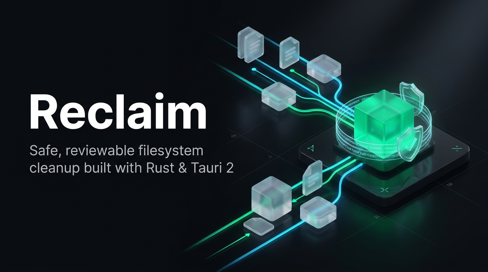

<div align="center">
  

  # Reclaim

  **A modern, cross-platform desktop application and CLI tool for finding duplicate files and performing safe, reviewable, recoverable filesystem cleanup.**

  [](https://github.com/reclaim-app/reclaim/actions/workflows/ci.yml)
  [](https://github.com/reclaim-app/reclaim/actions/workflows/release.yml)
  [](LICENSE)
  [](https://www.rust-lang.org)
  [](https://tauri.app)
  [](https://github.com/reclaim-app/reclaim)

  [Features](#key-features) • [Safety Invariants](#the-10-filesystem-safety-invariants) • [Architecture](#architectural-layers) • [Installation](#installation--quick-start) • [Test Suite](#verification--test-suite)
</div>

---

Reclaim is engineered from first principles with an unyielding directive: **filesystem safety, data preservation, and crash recovery take absolute precedence over speed or developer convenience.**

---

## Key Features

- **Read-Only Discovery**: Directory traversal and duplicate detection never alter, move, or touch user files.
- **Two-Stage Content Verification**: Fast candidate pre-filtering by exact file size and streaming 64 KB prefix hashes, followed by full **BLAKE3** cryptographic hashing.
- **Physical Hard-Link Awareness**: Queries physical filesystem file identity (`st_ino`/`st_dev` on Unix; `nFileIndexHigh`/`nFileIndexLow` on Windows) to correctly classify hard links and prevent phantom duplicate reporting (accounting for 0 B reclaimed).
- **Prospective, Immutable Planning**: Proposes quarantine actions with frozen preconditions (file sizes, `FileId`, cryptographic hashes) before any mutation is approved.
- **Durable SQLite State Machine**: Every state transition (`Planned` $\rightarrow$ `Validating` $\rightarrow$ `Executing` $\rightarrow$ `Completed` / `Failed` $\rightarrow$ `Reverted`) is recorded with microsecond timestamps in a local SQLite WAL journal with an append-only audit log.
- **Zero Silent Overwrites**: Low-level mutations use kernel-level atomic non-replacing syscalls (`libc::renameatx_np` with `RENAME_EXCL` on macOS; `libc::renameat2` with `RENAME_NOREPLACE` on Linux; `MoveFileExW` without `MOVEFILE_REPLACE_EXISTING` on Windows). Never relies on check-then-rename races.
- **Crash Reconciliation & Auto-Recovery**: If interrupted mid-operation (power cut, SIGKILL, kernel panic), Reclaim inspects the journal and physical disk state on startup, resolves dangling in-flight mutations, and prevents partially executed operations from being blindly repeated.
- **Conditional Undo Engine**: Completed quarantine actions can be safely reversed. If a destination path has been re-occupied or the preserved keeper is missing, Reclaim halts and logs a transparent conflict rather than overwriting data.
- **Native Desktop Interface**: Built with Tauri 2, React, and TypeScript. Native typography, high-density file inspection, live progress event streaming, side-by-side conflict cards, and Finder/Explorer integration.

---

## The 10 Filesystem Safety Invariants

Reclaim operates under ten strictly verified safety invariants:

| # | Invariant | Enforcement Mechanism |
|---|---|---|
| **1** | **No Mutation Without Approval** | Scanner, hasher, and planner are purely read-only; mutations require explicit user approval. |
| **2** | **No Silent Overwrites** | Kernel-level atomic non-replace syscalls (`RENAME_EXCL`, `RENAME_NOREPLACE`). |
| **3** | **No Unexpected Path Traversal** | Symlink-aware metadata (`symlink_metadata`); symbolic links and junctions are rejected during mutation. |
| **4** | **No Trust in Stale Metadata** | Preconditions (file size, `FileId`, BLAKE3 hash) re-checked immediately before syscall execution. |
| **5** | **No Unsafe Deletion** | Reversible quarantine moves only; permanent deletion is strictly out of scope. |
| **6** | **Preserve Verified Content** | Candidate duplicate is never quarantined unless the keeper exists, is accessible, and content hash matches. |
| **7** | **Honest Undo Guarantees** | Reversal is conditional; if a destination path is occupied, Reclaim fails closed and retains the quarantine copy. |
| **8** | **Crash Recovery** | SQLite intent is committed before mutation; startup reconciliation inspects disk state after unexpected termination. |
| **9** | **Honest Durability Claims** | SQLite WAL mode durability; clear distinction between filesystem state and database transactions. |
| **10** | **Fail Closed** | If an OS capability is unsupported or an access check fails, Reclaim aborts rather than falling back to weaker checks. |

---

## Architectural Layers

Reclaim strictly separates concerns into 6 decoupled architectural layers:

```text
[ Layer F: Desktop Interface (Tauri 2 + React + TypeScript) ]
                          |
[ Layer D: Safe Executor ] <---> [ Layer E: Recovery & Conditional Undo ]
           |                                  |
           +----------------+-----------------+
                            |
           [ Layer C: Prospective Cleanup Planner ]
                            |
           [ Layer B: Exact Duplicate Detection ]
                            |
           [ Layer A: Read-Only Filesystem Scanner ]
                            |
              [ Physical Operating System / Storage ]
     macOS (APFS/HFS+) | Windows (NTFS) | Linux (ext4/btrfs)
```

1. **Layer A — Read-Only Filesystem Scanner (`reclaim-core::scanner`)**: Safe directory walker collecting file metadata, file size, timestamps, and physical file identity (`FileId`).
2. **Layer B — Exact Duplicate Detection (`reclaim-core::duplicates`)**: Size grouping, 64 KB prefix filtering, streaming BLAKE3 hashing, and hard-link alias deduplication.
3. **Layer C — Prospective Cleanup Planner (`reclaim-core::planner`)**: Deterministic keeper selection policies (`ShortestPath`, `PreferredDirectory`, `NewestModified`, `OldestModified`), prospective relative quarantine path generation, and TOCTOU precondition capture.
4. **Layer D — Safe Executor (`reclaim-storage::executor`)**: Revalidates preconditions immediately before execution, enforces volume/filesystem boundaries, writes intent to SQLite journal before mutation, and executes kernel atomic non-replacing moves.
5. **Layer E — Recovery & Conditional Undo (`reclaim-storage::recovery` & `reclaim-storage::undo`)**: Reconciles interrupted sessions on startup against physical storage; provides conditional reversal with destination vacancy checks and cryptographic verification.
6. **Layer F — Desktop Interface (`apps/desktop`)**: Tauri 2 IPC commands, React state machine, real-time progress monitors, duplicate inspector, and explicit approval review modals.

---

## Installation & Quick Start

### 1. Desktop Application
Download the latest native release for your platform from [Releases](https://github.com/reclaim-app/reclaim/releases):
- **macOS**: Drag `Reclaim.app` into `/Applications`.
- **Windows**: Run `Reclaim-Setup.exe` or `Reclaim.msi`.

To run from source in development mode:
```bash
cd apps/desktop
npm install
npm run tauri dev
```

### 2. Command-Line Interface (CLI)
Install globally with Cargo:
```bash
cargo install --path crates/reclaim-cli
```

Common commands:
```bash
# 1. Read-only directory traversal
reclaim scan ~/Downloads

# 2. Identify exact duplicates using BLAKE3
reclaim duplicates ~/Downloads

# 3. Prospective cleanup plan preview (no files moved)
reclaim plan ~/Downloads --policy shortest-path

# 4. Safe quarantine simulation (dry-run mode)
reclaim execute ~/Downloads --dry-run

# 5. Session history & journal audit logs
reclaim history
```

---

## Verification & Test Suite

The workspace is protected by a deterministic test suite containing **100 automated unit, integration, recovery, and fault-injection tests**:

```bash
cargo test --workspace
```

```text
running 100 tests
test scanner_tests::test_nested_directories_and_byte_counts ... ok
test duplicate_tests::test_pure_hard_links_zero_reclaimable_bytes ... ok
test mutation_tests::test_atomic_move_destination_collision ... ok
test executor_tests::test_executor_stale_content_modification_detected ... ok
test recovery_tests::test_recovery_move_never_executed_file_still_at_source ... ok
test undo_tests::test_undo_conflict_destination_occupied ... ok
test fault_injection_tests::test_fault_injection_crash_before_filesystem_mutation ... ok
test fault_injection_tests::test_fault_injection_tampered_quarantined_file_refuses_undo ... ok
...
test result: ok. 100 passed; 0 failed; 0 ignored; finished in 0.42s
```

---

## Continuous Integration & Packaging

Automated workflows are managed via GitHub Actions:
- **`ci.yml`**: Runs on push/PR for `macos-latest`, `windows-latest`, and `ubuntu-latest`. Enforces `cargo fmt`, `cargo check`, `cargo clippy -D warnings`, all workspace tests, and frontend production builds.
- **`release.yml`**: Compiles native desktop bundles (`.dmg` for macOS, `.msi`/`.exe` for Windows) and publishes tagged releases.

---

## License

Reclaim is licensed under the [MIT License](LICENSE).
